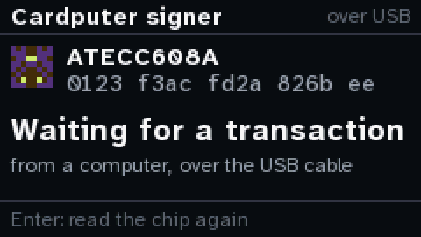
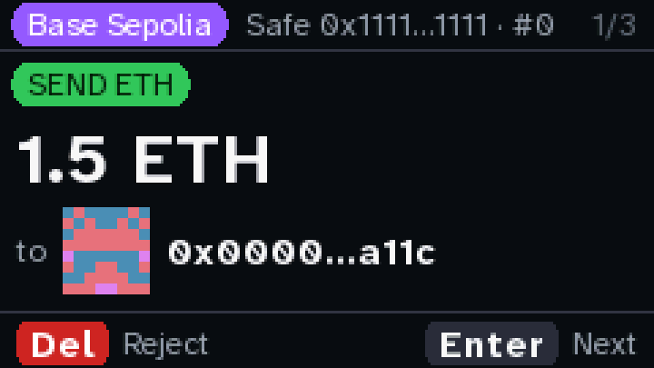
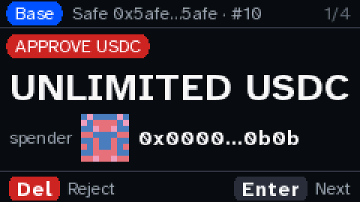
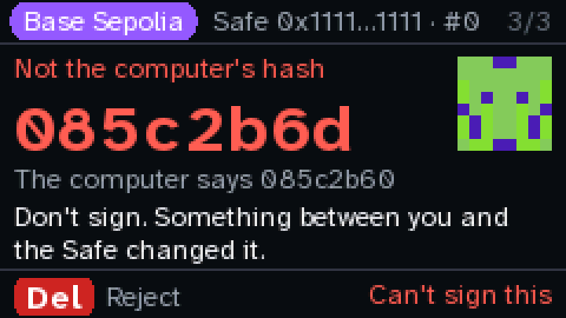
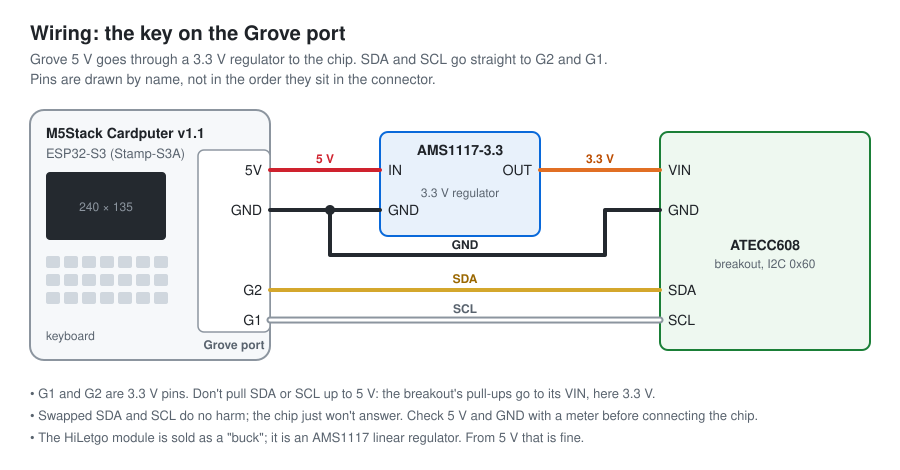

# diykey

A hardware signer for [Safe](https://safe.global) multisig wallets on Ethereum and chains like it,
made from parts you can buy: an M5Stack Cardputer (ESP32-S3) and an ATECC608 secure element on its
Grove port. The key is made inside the chip and can't be read out. The device shows what a
transaction does on its own screen, works out the transaction's hash itself, and will sign only that
hash.

This repository is how I built mine: the parts and the wiring, the firmware, and a log of what ran.

**Try it without building anything: [diykey.app](https://diykey.app).** The same firmware code runs
in your browser as an emulator, with your passkey (iPhone, Android, Mac, Windows, a security key) as
its key in place of the ATECC608. It works out the hash, shows every page, and your passkey signs
only that hash. How a passkey compares with the chip: [docs/PASSKEY.md](docs/PASSKEY.md).

| | | | |
|---|---|---|---|
|  |  |  |  |
| **Idle.** The chip, read. | **What it does.** In plain words. | **Red pages.** For what can't be undone. | **Its own hash.** A wrong claim turns it red. |

The screens are drawn on a laptop by the same code the device runs (`cargo run --example screens`).

> **An experiment. Testnet only. Not audited.** The Cardputer can't sign yet (milestone 3); the
> emulator signs with a passkey, and nothing is sent to a Safe yet. The chip's key can't leave the
> chip, but the firmware isn't locked down: there is no secure boot, so anyone with the cable could
> flash firmware that shows one thing and signs another.

## How it works

1. A computer sends the transaction's fields over USB, as one line of text.
2. The Cardputer rebuilds the Safe's EIP-712 transaction hash from those fields, for the chain and
   Safe they name. It never takes a hash from the computer: a hash the computer claims (`expect`) is
   only compared, and if it differs, the hash page turns red and says not to sign.
3. It shows what the transaction does, one page at a time: the amount, who it goes to, the raw
   fields, then the hash with its last eight characters and its blockie, to check with whoever
   proposed it. Anything it can't read is red.
4. Del rejects with one press. Hold to sign is milestone 3: the chip will sign the hash the device
   worked out, and nothing else.

Bare-metal Rust (`esp-hal`, no OS). The device has no Wi-Fi; the only way in is the USB cable.

## Where it is

| Milestone | What | Status |
|---|---|---|
| 1 | The screen, the keyboard, and the chip read (serial, revision, locks, counter 0) | done; on the bench 2026-10-12 |
| 2 | A transaction over USB, its Safe hash worked out on the device, the review pages | runs; the hash and the refusals checked over USB, paging and Reject not yet by hand |
| 3 | Hold to sign with the chip, over the hash it worked out | |

The details, with dates: [docs/BUILDLOG.md](docs/BUILDLOG.md).

## Build one

You need a Cardputer v1.1 (not the newer Cardputer-Adv, whose keyboard is wired differently), an
ATECC608 breakout, an AMS1117-3.3 regulator module and a Grove cable.
The Grove port gives 5 V, and the ESP32-S3's pins take 3.3 V at most, so the chip runs from the
regulator's 3.3 V. Parts, a shopping list, wiring and checks: [hardware/](hardware/README.md). How
the chip gets its key: [the key ceremony](docs/CEREMONY.md), an image of its own that writes,
locks and seals the chip, built and tested on a virtual chip but not yet run on a real one.



### Build the firmware

```sh
# once: Rust, then Espressif's Rust for the S3 (Xtensa), and espflash
curl --proto '=https' --tlsv1.2 -sSf https://sh.rustup.rs | sh
cargo install --locked espup espflash
espup install --targets esp32s3

# the tests and the screen previews, on the laptop
cd core && cargo test --locked && cargo run --locked --example screens

# the firmware
. ~/export-esp.sh
cd firmware && cargo build --release --locked
```

On macOS 27 with Command Line Tools whose default SDK the linker can't read, nothing links. Point
the build at an older SDK: `export SDKROOT=/Library/Developer/CommandLineTools/SDKs/MacOSX26.5.sdk`.

Every crate is pinned exactly in `Cargo.toml`, and `Cargo.lock` pins each one by hash. Build with
`--locked`.

### Flash it

**This replaces whatever is on the board.** Keep a full image first:
`esptool.py --port /dev/cu.usbmodem* read_flash 0 ALL backup.bin`.

```sh
cd firmware && cargo run --release      # espflash flash --monitor --chip esp32s3
cd firmware && cargo run --release --bin ceremony   # the key ceremony instead (docs/CEREMONY.md)
```

### Send it a transaction

```sh
uvx --with pyserial==3.5 python host/send.py --list                    # the test vectors
uvx --with pyserial==3.5 python host/send.py eth-send-base-sepolia
uvx --with pyserial==3.5 python host/send.py --tamper erc20-transfer   # claim a wrong hash
uvx --with pyserial==3.5 python host/send.py --json my-tx.json
```

A transaction is one line of text (`core/src/proto.rs`):
`tx chain=… safe=… to=… value=… data=0x… op=0|1 nonce=… [safetxgas= basegas= gasprice= gastoken=
refundreceiver=] [expect=0x…]`. The device answers `= hash 0x…` with the hash it worked out, then
`= rejected` when Del is pressed. While one transaction is on the screen, another gets `= busy`.

On the device: Enter or `/` for the next page, `,` for the one before, Del to reject.

### Or use the web page

`web/` is the page at [diykey.app](https://diykey.app). It sends the demo transactions to a signer,
shows the hash the signer works out next to the one the page claims, and draws every page it shows.
The signer is either:
- **the emulator**: `core` compiled to WebAssembly (`wasm/`), the same code as the firmware, with a
  passkey as its key. On the last page, Enter asks the passkey to sign the hash the emulator worked
  out, and the page checks the signature. It runs in any current browser, phones included.
- **your Cardputer over USB** (Chrome or Edge, Web Serial). The page can flash either image too: the signer, or the key ceremony, whose log it checks.

To run it on your own computer:

```sh
./web/build.sh                              # the screens, the emulator and the firmware image
python3 -m http.server 8642 --bind 127.0.0.1
# then open http://localhost:8642/web/      (localhost, not 127.0.0.1: passkeys need a name)
```

It loads nothing from anywhere else (its Content-Security-Policy says so). The browser works out the
Safe hash itself (`web/lib/safe.js`) and claims it; the signer works out its own and only compares.
`node web/test.mjs` checks the page's hash, blockies and passkey checks against the vectors, and the
emulator through its states. `node web/e2e.mjs` runs the emulator and a passkey end to end in
Chrome, with Chrome's virtual authenticator. Flashing uses Espressif's esptool-js, pinned in
`web/vendor/esptool-js/` with its checksums; the image's SHA-256 is checked before writing.

GitHub Actions builds the site from source on every push to main and deploys it to diykey.app
(`.github/workflows/site.yml`).

## What was checked

- `core`: the Safe hash against all 17 vectors in `vectors/safe_tx.json` (domain separator and
  safeTxHash), two of them real Ethereum mainnet transactions. Blockies against 7 seeds drawn by the
  Python version. The ATECC608 packets against the bytes the MicroPython driver sends.
- `core`: the decoder says what the MicroPython decoder says (summary, items, levels) for the 11
  vectors it reads. For the other 4 (batches, owner and threshold changes, a Uniswap swap) it says
  red, never kinder. Every page of all 17 vectors draws. Amounts and the nonce are never cut: they
  wrap.
- `firmware`: builds for `xtensa-esp32s3-none-elf` (160 KB). On a Cardputer v1.1 with an ATECC608A,
  milestones 1 and 2 as in [the build log](docs/BUILDLOG.md).

Where the vectors come from: [vectors/SOURCE.md](vectors/SOURCE.md).

## Layout

| path | what |
|---|---|
| `core/` | everything that isn't hardware, `no_std` and no heap: the Safe hash, the ATECC608's packets (`atecc.rs`, read commands only), blockies, the fonts, a framebuffer and the screens; and the key ceremony's commands, steps and pages (`ceremony*.rs`), which only the ceremony image uses. It runs on the laptop, and its tests run the ceremony on a virtual chip. |
| `firmware/` | the Cardputer: the panel (SPI), the chip (I2C), the keyboard, lines over USB (`src/lib.rs`). Two images: the signer (`src/bin/main.rs`) and the key ceremony (`src/bin/ceremony.rs`). They draw with `core`. |
| `host/send.py` | sends a transaction from the computer and prints what the device says |
| `web/` | the page at diykey.app: the emulator, the Cardputer over USB, flashing either image, and checking the key ceremony's log; and the key ceremony's page |
| `wasm/` | the emulator: `core` in WebAssembly, the firmware's states, a passkey as its key |
| `vectors/` | test vectors from outside this code |
| `fonts/` | Atkinson Hyperlegible Next and Mono as 4-bit bitmaps (SIL OFL 1.1, `fonts/OFL.txt`) |
| `hardware/` | the parts, the wiring diagram, and later a case |
| `docs/` | the build log, the key ceremony, and the screen previews above |

## Where it comes from

This started with [picowallet](https://github.com/austintgriffith/picowallet) by **Austin
Griffith**: a hardware wallet built from three off-the-shelf parts in an evening, no soldering: a
Raspberry Pi Pico 2 W, a Waveshare Pico-LCD-1.3 and Adafruit's ATECC608 breakout. picowallet showed that a small board can drive a secure element from
MicroPython, rebuild an EIP-712 digest on the device, show it on its own screen, and sign with a key
that never leaves the chip. On 2026-09-05 it sent 69 USDS on Ethereum mainnet that way.

I built a MicroPython signer for Safe multisigs on top of picowallet's code, then ported it to the
Cardputer and to Rust. Three pieces here go back to MicroPython files that started in picowallet,
and are under its MIT license:
- the ATECC608 packets and wake sequence (`core/src/atecc.rs`), from `atecc.py`
- blockies (`core/src/blockies.rs`), from `blockies.py`
- the screen's start-up sequence (`firmware/src/bin/main.rs`), from `lcd.py`

Everything else this uses is credited in [NOTICE](NOTICE).

This project isn't affiliated with M5Stack, Microchip, Safe or picowallet.

## License

MIT ([LICENSE](LICENSE)), with Austin Griffith's copyright for the parts from picowallet. The fonts
are under the SIL Open Font License 1.1 ([fonts/OFL.txt](fonts/OFL.txt)).
