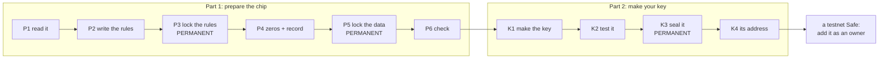
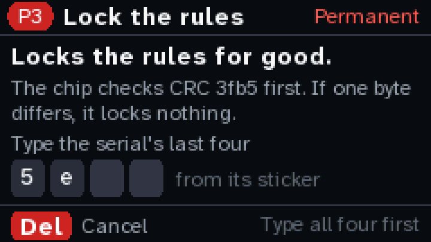
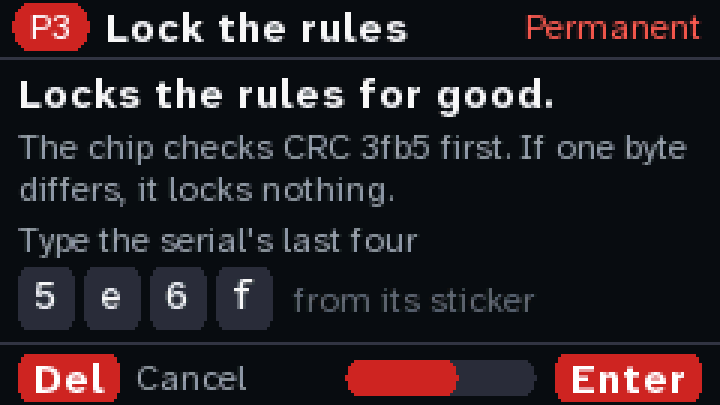

# The key ceremony

How a fresh ATECC608 becomes a diykey key. The chip gets its rules and they are locked. Then the
chip makes a key that nobody chose and nobody can read out, and the key is sealed.

> **Written 2026-10-14; the ceremony image built 2026-10-15, and not yet run on a chip.** It is its
> own image (`firmware/src/bin/ceremony.rs`), flashed from [diykey.app](https://diykey.app/#flash)
> beside the signer. The signer still holds read commands only (`core/src/atecc.rs`). The steps
> ran on silicon from the MicroPython signer this one was ported from, on two ATECC608A chips
> ([what ran](#what-has-run-on-silicon)); this Rust image has run them only on a virtual chip, in
> `cargo test` ([how it's built](#how-its-built)). Locks are permanent, so the first time through is
> on a spare chip.
>
> **2026-10-16: the keys are [key-c boards](#the-key-key-c) now**, five of them, each an ATECC608C
> behind a USB-C socket. A 608C hasn't been through any of this yet, and the image refuses one for
> now. What key-c adds is a plan, not in the image yet: the red page for a revision not tried yet,
> the key's name, the board and name in the record, and the serial read again before each change.

## The short version

The ceremony has two parts.

1. **Prepare the chip.** Write the rules, lock them, fill the unused slots with zeros, and lock the
   data zone. Two permanent steps. After them, the chip's own rules let nothing write a key into
   slot 0. Only the chip's GenKey can make one there.
2. **Make your key.** GenKey makes the key inside the chip. Test it, seal it, and work out its Safe
   signer address. One permanent step.

Part 1 makes no key. So Part 1 can be done by someone else, and Part 2 still gives a key only you
asked for. That is what makes a [branded key](#a-branded-key) possible later. To start with, you
run both parts on your own Cardputer.



## The key: key-c

key-c is a 16 × 36 mm board I designed for the key: an ATECC608C (SOIC-8) behind a USB-C socket.
JLCPCB made and assembled five in 2026-10. The socket is only wires, not USB:
- D+ is SDA, D− is SCL, and VBUS powers the chip. Both rows of the socket are wired, so the plug
  goes in either way up.
- A 5.1 kΩ resistor on each CC pin, and an ESD array between the socket and the chip.
- No pull-ups on SDA and SCL. The Cardputer's end has them.
- Four test pads on the back.

How it goes on the Cardputer, and the meter checks before the first plug-in:
[hardware/](../hardware/README.md#key-c-the-key-on-a-usb-c-board).

What it changes for the ceremony:
- **A 608C.** Microchip says the 608C has the 608B's config zone, slots and commands, and the 608B
  the 608A's. No new config bits. Command times differ a little, and the driver polls for every
  answer, so a slower command just takes one more poll. Info says `00006005` (Microchip's note; P1
  reads it on every chip). This table has run on 608As only, so the first key-c is the rehearsal.
- **It unplugs.** The ceremony and the signer can't see it go: the Grove port has no pin to spare
  for CC. So both read the serial again before anything that changes the chip
  ([decision 10](#the-decisions)).
- **Five boards.** A rehearsal, two keys, a replacement and a blank spare ([the bench](#the-chips-on-my-bench)).
- **The key alone can sign** ([decision 11](#the-decisions)). A key in a pocket is easier to lose
  than a chip wired to a Cardputer.

## What you trust, and what you don't

- **The chip.** Microchip's silicon makes the key with its own random number generator, and keeps
  it. An ATECC608 can't prove it is genuine (it has no factory certificate), so buy it from a known
  seller.
- **The ceremony image you flash.** It is the one program that could cheat. Before the data lock it
  could write a key it knows into slot 0 and say GenKey made it. Build it yourself from a commit
  you've read, or compare its SHA-256 with the one the page shows.
- **Not the computer.** Nothing secret goes over the cable: the key never leaves the chip. What goes
  over USB is the rules, the public key and test signatures.
- **Not whoever ran Part 1**, if it wasn't you. After the data lock the chip refuses to write a key
  into slot 0, and K1 always makes a new one.

The ceremony doesn't change what the README says about the firmware: there is no secure boot, so
anyone with the cable could flash a signer that shows one thing and signs another.

## The decisions

1. **The key is made after the data lock.** While the data zone is open, PrivWrite can put a known
   key into any key slot, whatever the slot's rules say. After the lock, slot 0's rules hold, and
   they allow only GenKey. So Part 2 comes after the lock. K1 always makes a new key, even if slot 0
   already holds one: a key you didn't see made is replaced, never used.
2. **One table, the one that has already run.** The rules are, byte for byte, the table the
   MicroPython signer locked on 2026-10-07. A new table would put new unknowns on a permanent step.
3. **Every zone lock checks a CRC.** The ceremony works out the CRC of what the zone must hold from
   the reviewed table, never from a readback. If one byte differs, the chip refuses to lock. A
   refused lock locks nothing.
4. **No PIN.** The ATECC608 has no lockout: at about 40 tries a second, a 6-digit PIN falls in about
   7 hours. A forgotten PIN makes the chip useless, and a PIN's rules can only be tried after the
   data lock. The Safe's threshold is the protection.
5. **A use counter.** Every signature raises counter 0, which only goes up, to 2,097,151 at most.
   Once the data zone is locked, a read of the public key counts too (seen on silicon). The signer
   already reads the counter before it reads the key.
6. **No backup.** There is no seed phrase and nothing to write down. If you lose the chip, the
   Safe's other owners swap it out. Keep the threshold reachable without it.
7. **Its own firmware image.** The write, lock and GenKey commands live in a ceremony image, not in
   the signer. You flash it, run it, and flash the signer back. The signer keeps its read commands,
   plus Sign (milestone 3).
8. **The chip says where you are.** The ceremony works out its step from the chip's state, not from
   anything it stored. Unplug at any point, and it starts again where the chip is. Before the seal,
   that means a new key.
9. **The test signatures are the signer's own kind.** K2 signs the WebAuthn message over the Safe
   hash of a fixed test transaction, worked out on the device. It never signs a digest from the
   computer.
10. **The serial again, right before every write, lock, GenKey and Sign.** The ceremony wakes the
    chip, reads config block 0 and compares the serial with the one on the screen. A config read
    doesn't count as a use. A different serial, or no answer, stops the step with nothing written,
    and the ceremony starts again from the chip's state (decision 8). The signer does the same
    before every Sign: a key swapped during a review ends the review. Planned: the image doesn't do
    this yet.
11. **The key alone can sign.** The chip signs any digest it is sent. "Only the hash it worked out"
    is the Cardputer's rule, not the chip's. Whoever holds a key-c and any microcontroller can make
    it sign. So:
    - the Safe's threshold is the protection, as in decision 4
    - a lost key is swapped out of the Safe at once, not waited for
    - counter 0 is the tell: write it on the key's sticker ([what to keep](#what-to-keep)). A key
      that comes back with a higher number was used.

    Considered and not chosen: making slot 0 need an authorization key that only its Cardputer
    holds. The Cardputer's flash isn't encrypted, so anyone with its cable could read that key. And
    it is a new table on a permanent step (decision 2).

## The rules: diykey v1

```
  0: 01 23 00 00 00 00 60 00 00 00 00 00 ee 00 00 00   the chip's own bytes (never written)
 16: c0 00 00 00 a1 2f 9f 8f 9f 8f 9f 8f 9f 8f 9f 8f
 32: 9f 8f 9f 8f 1f 8f 9f 8f 9f 8f 9f 8f 9f 8f 9f 8f
 48: 9f 8f 9f 8f ff ff ff ff 00 00 00 00 ff ff ff ff
 64: 00 00 00 00 00 00 00 00 00 00 00 00 00 00 00 00
 80: 00 00 00 00 00 00 55 55 ff ff 00 00 00 00 00 00   84-87 are the chip's own too
 96: 33 00 1c 00 1c 00 1c 00 1c 00 1c 00 1c 00 1c 00
112: 1c 00 1c 00 1c 00 1c 00 1c 00 1c 00 1c 00 1c 00
sha256 36da855657a3ee7e098f27cd17b2a636c9e51adec02d252ee0adbe905b8113e1
```

| slot | SlotConfig / KeyConfig | what it is |
|---|---|---|
| 0 | `0x2FA1` / `0x0033` | **Your key.** P-256, made by GenKey. External Sign only: no internal sign, no ECDH. Once the data zone is locked, never the Write command and never PrivWrite. Its public key can be read. LimitedUse: every signature raises counter 0. Lockable: K3 seals it. |
| 8 | `0x8F1F` / `0x001C` | 416 bytes of plain data, readable once the data zone is locked and never writable after it. Zeros on your own chip; a brand signature on a branded one. |
| 1–7, 9–15 | `0x8F9F` / `0x001C` | **Dead.** Data, secret (never readable), never writable after the data lock, not lockable. Zeros. |

The rest of the header: I2C address 0x60 (`C0`). CountMatch off. ChipMode 0, so the chip's
watchdog is 1.3 s. Both counters at 0. SecureBoot, KDF, IO protection, UseLock and VolatileKey are
all off: the signer uses none of them. SlotLocked is `FF FF`, because a cleared bit at the config
lock would seal slot 0 before it ever had a key.

## The ceremony

### Before you start

- The Cardputer, with the chip wired and checked as in [hardware/](../hardware/README.md). For a
  key-c, the board metered first ([hardware/](../hardware/README.md#key-c-the-key-on-a-usb-c-board)).
- **A spare chip the first time.** A breakout costs about $5. Take the spare all the way through K4.
- USB power and a charged battery. Don't unplug on a red page, and don't pull the key out.
- A pen. Write each chip's serial on a sticker on its board, grouped as the screen shows it
  (`0123 4a7b 9c2d 5e6f ee`). On a key-c it goes on the back, clear of the test pads, or on its
  case. Keep the chips you aren't using off the Grove port.
- The ceremony image, flashed from the page ("The key ceremony" on the flash card), or with
  `cd firmware && cargo run --release --bin ceremony`. The page shows its SHA-256 and the commit it
  was built from, and checks it before writing.

### The keys

- **Enter** does the step, or goes on.
- **Del** backs out at any point, with one press. Nothing is written.
- **A permanent step** is a red page that says what can't be undone. Type the last group of four in
  the chip's serial, from its sticker (`5e6f` above: every serial ends in `ee`), then hold Enter for
  3 seconds while a bar fills. Letting go early does nothing. The page doesn't show the four, so you
  read them off the chip in your hand, and the spare is never mistaken for the real one.

| Type the four | Then hold Enter |
|---|---|
|  |  |

These pages are the ceremony image's own, drawn on a laptop by the same code from a rehearsal on a
virtual chip (`cargo run --example ceremony`). Every page of the ceremony is on
[diykey.app/ceremony.html](https://diykey.app/ceremony.html).

### Part 1: prepare the chip

| Step | What it does | What it checks | Permanent? |
|---|---|---|---|
| P1 Read the chip | Reads everything. The page saves the factory config to the log. | It answers at 0x60; both zones open (`55 55`); SlotLocked `FF FF`; Random gives the fixed pattern of an unlocked chip; SelfTest passes. The revision: `00006002` (a 608A) goes on. A revision no chip has taken through K4 yet (`00006003`, a 608B, and `00006005`, a 608C) is refused for now; the plan is [a red page](#a-revision-not-tried-yet) first. It refuses anything else and says why: a used chip, a TrustFLEX or Trust&GO part (they come locked), an unknown revision. | no |
| P2 Write the rules | Writes the table into the config zone, except the chip's own bytes (0–15 and 84–87). Reads it back. | The readback is the table. The screen shows the config CRC. The page works the CRC out on its own from P1's saved bytes, and the two should match. | no: it can be written again |
| P3 Lock the rules | Lock, mode `0x00`, with that CRC. | If one byte differs, the chip refuses and locks nothing. Afterwards: config locked, the table unchanged, Random live. | **yes** |
| P4 Zeros and the record | Asks for [the key's name](#its-name) (planned). Zeros into slots 1–15, in 32-byte writes: before the data lock, the chip refuses 4-byte writes into secret slots. [The record](#the-record) into OTP. The screen shows the data CRC. | Each write is accepted. P5's CRC checks what they wrote. | no, until P5 |
| P5 Lock the data | Lock, mode `0x01`, with the CRC of every slot that isn't a key (1–15, in order), then OTP. | If one byte differs, the chip refuses and locks nothing. Afterwards: data locked, OTP and slot 8 read in the clear, slot 1 can't be read. | **yes** |
| P6 Check | Reads it all back. | Both zones locked; the table; the record; slot 0 empty, checked with Info, which doesn't count as a use; counter 0. | no |

### Part 2: make your key

| Step | What it does | What it checks | Permanent? |
|---|---|---|---|
| K1 Make your key | GenKey, mode `0x04`, on slot 0. Always, whatever is there. Reads the public key and shows its fingerprint. | Slot 0 holds a valid key, and its public key reads back. GenKey on slot 1 is refused. | no: until K3, running K1 again makes a different key |
| K2 Test it | Signs two test transactions, each the WebAuthn message over a Safe hash it works out from fixed fields: Base Sepolia, a Safe at address zero, which no Safe can be, so the signatures can't approve anything. Sends them over USB. | The page checks both with WebCrypto, as it checks a passkey's signatures. Counter 0 went up by exactly the signatures and key reads. Sign on slot 1 is refused. | no |
| K3 Seal it | Lock, mode `0x82`: slot 0 alone. | SlotLocked reads `FE FF`. The public key is the one K2 tested. One more signature checks. | **yes** |
| K4 Its address | Works out the Safe signer address from the public key, with its blockie. | The Cardputer's address and the page's match. | no |

### A revision not tried yet

Planned: the image refuses these at P1 for now, and the page below is a mockup.

A 608B or a 608C, until one of its kind has been through P1 to K4 and into the build log. P1 shows
a red page before P2:

> **Not tried on a 608C yet.** Its rules should be a 608A's. Go on only with a spare you can lose.

The serial gate and the 3-second hold, as on any red page. Nothing is written on this page, but
it is where a mistake would start. Once a spare of that revision has been through, its revision
moves into the plain list in the next ceremony image.

### Its name

Planned: the image doesn't ask yet, and writes zeros where the name goes.

At P4 the Cardputer asks for a name for the key, up to 16 characters: letters, digits, spaces and
`-`. It goes into [the record](#the-record) and is frozen at P5. The signer's idle screen shows it
beside the serial, so with five keys on the desk, you know which one is in.
- Del leaves it empty. An empty name is fine.
- Anyone holding the key can read it, so a colour or a number is better than whose it is or where
  it lives: `key 2 blue`, not `office drawer`.
- A name can't be changed after P5. A sticker can.

### What to keep

The page checks what the ceremony prints as it goes, and saves every line as a text file ("Save the
log"):
- the serial, the revision and the factory config
- the config CRC and the data CRC
- the public key and the Safe signer address
- counter 0 after each step
- the ceremony image's commit and SHA-256

Nothing in it is secret. Publish it if you like.

And on the key's sticker, under the serial: **counter 0**, as K4 leaves it. Write the new number
each time you sign with it. The idle screen shows counter 0, so a key that comes back reading more
than its sticker was used without you ([decision 11](#the-decisions)).

### Afterwards

1. Flash the signer back. Its idle screen shows the chip, and the page shows the key and its
   address.
2. Check the address with Safe's passkey factory, `getSigner`, on Base Sepolia, from a block
   explorer's Read Contract tab or with `cast call`. The page doesn't do this, because it loads
   nothing from anywhere else.
3. Add the address as an owner of a testnet Safe, with a threshold you can reach without it: for
   example 2 of 3, with a passkey and a wallet. The signer contract is deployed when a Safe needs it.
   Any wallet can call the factory's `createSigner`.
4. Don't send funds to the address. It only signs ([PASSKEY.md](PASSKEY.md)).

## The record

64 bytes in the OTP zone, written at P4 and frozen by P5. Integers are big-endian.

| Offset | Size | What |
|---|---|---|
| 0 | 2 | `DK` |
| 2 | 1 | 1: this layout |
| 3 | 1 | 1: the table, diykey v1 |
| 4 | 9 | the chip's serial |
| 13 | 4 | its revision |
| 17 | 2 | the config CRC that P3 locked with |
| 19 | 4 | the commit the ceremony image was built from, first 4 bytes |
| 23 | 1 | who prepared it: 0 its owner, 1 a diykey bench (a branded key) |
| 24 | 3 | the number on its label, if branded; else 0 |
| 27 | 16 | the brand key's id, SHA-256(x ‖ y) first 16 bytes, if branded; else zeros |
| 43 | 1 | the board: 0 a breakout, 1 a key-c P2 (planned; the image writes 0) |
| 44 | 16 | [its name](#its-name), ASCII, zeros after it; all zeros if none (planned; the image writes zeros) |
| 60 | 4 | zeros |

The record holds no key, because there is no key yet when it is frozen. It only says how the chip
was prepared. The signer always reads the live key.

## The chips on my bench

| chip | what it is | what it gets |
|---|---|---|
| `0123f3acfd2a826bee` | 608A breakout. Its config was locked on 2026-09-17 with Microchip's test table, and the key in slot 0 is sealed. Data zone open. | Nothing. P1 refuses it. It stays the development chip, signer address `0x2843…5E53`. |
| `01233859…` | A breakout, its revision not checked yet. Both zones open, no key (read 2026-10-14). | Kept blank for now. Later, the Rust ceremony on it, so a breakout has run it too. |
| key-c 1 | 608C, from JLCPCB. Not read yet. | **The rehearsal**, P1 to K4, through [the red page](#a-revision-not-tried-yet). Afterwards a working testnet key, and the 608C goes into the plain list. |
| key-c 2, 3 | the same | **The keys.** Owners of a testnet Safe, 2 of 3, with a passkey as the third. |
| key-c 4 | the same | **The replacement**, for [the lost-key drill](#the-lost-key-drill). |
| key-c 5 | the same | **Kept blank**: the spare for the next ceremony image or the next table. |

Every key-c gets the meter checks and a plain read on the signer first: its serial, revision
`00006005`, both zones open. Only the board being worked on is in the socket.

## The lost-key drill

Decision 6 says a lost key is swapped out by the Safe's other owners. The drill shows that it works,
on testnet, before any key matters:
1. The Safe: key-c 2, key-c 3 and a passkey, threshold 2.
2. Say key-c 3 is lost. Put it in a drawer.
3. Key-c 2 and the passkey sign `swapOwner`, from key-c 3's address to key-c 4's. The signer shows
   it as an owner change, in red.
4. Check: the Safe lists key-c 4, and a transaction signed by key-c 3 and key-c 2 is refused.
5. Key-c 3's counter 0 reads what its sticker says: it wasn't used while it was "lost".

Into the build log, with the transaction hashes. It needs Sign (milestone 3), and a way to send the
signatures to the Safe, which the page doesn't have yet.

## What has run on silicon

The MicroPython signer ran these steps on a Raspberry Pi Pico 2 W, with Adafruit 4314 breakouts
(ATECC608A, revision `00006002`). Its code isn't in this repository.

- **2026-09-26, a fresh chip, the whole ceremony in the older order**: the key was made and sealed
  before the data lock, and the table had slot 8 secret. What it settled:
  - the CRC's byte order in Lock (`crc[0] | crc[1] << 8`)
  - the data CRC's layout: every slot that isn't a key, then OTP
  - before the data lock, the chip refuses 4-byte writes into secret slots and takes 32-byte ones
  - once the data zone is locked, a public-key read counts as a use
- **2026-10-07, a spare, with this table and in this order**: the data lock, then the key, then the
  seal. What it settled:
  - GenKey works after the data lock, on a slot that never held a key
  - slot 8 reads in the clear after the lock, and is in the data CRC
  - refused afterwards, with counter 0 unmoved: GenKey on the sealed slot and on slot 1; Write to
    slots 0, 1 and 8, to OTP and to the config; both zone locks again; Sign and Read on slot 1
  - a WebAuthn signature from it passed Safe's `isValidSignatureForSigner` on Base Sepolia, and a
    wrong hash didn't

Not run: anything on a 608B or a 608C, and anything from this Rust firmware or a Cardputer.

## In the emulator

At [diykey.app](https://diykey.app) the key is a passkey. Making one is this ceremony, run by your
authenticator:

| | the chip | a passkey |
|---|---|---|
| the rules | yours, written and locked in Part 1 | the authenticator maker's |
| making the key | K1: GenKey, inside the chip | "Make a passkey": inside the Secure Enclave, a TPM or a security key |
| testing it | K2 | the page checks every signature |
| sealing it | K3: the slot lock | it can't be changed, but a synced passkey is copied to your other devices |
| its address | K4 | the key card |

The ceremony itself could run in the page too: the same code, on a virtual chip. That is the
rehearsal in [what's left](#whats-left).

## A branded key

An option for later. Part 1 is where the mistakes happen: a table, two CRCs, two permanent locks
and the silicon's quirks. Part 2 is where the key is made. Because Part 1 makes no key, different
people can do the two parts. The project could run Part 1 on a bench, add a brand, and send the
chips out. Each owner then runs Part 2 on their own Cardputer.

- **What the bench adds, at P4:** the record says "a diykey bench" and the chip's number, and slot 8
  holds the brand key's signature over SHA-256("diykey brand v1" ‖ the record). P6 checks slot 0
  with Info, never with a public-key read, so the chip leaves with counter 0 at 0.
- **What the owner's Cardputer checks before K1:**
  - the brand signature, under the brand key pinned in the firmware
  - that the record's serial, revision and config CRC match the chip in front of it
  - that both zones are locked and slot 0 isn't sealed

  The check runs on the Cardputer or on the page, never on the chip being checked: a fake chip would
  just say yes. On the Cardputer it needs P-256 code the firmware doesn't have; the page has
  WebCrypto.
- **The brand key, diykey key 0000:**
  - It is a diykey itself, a Cardputer and a chip, through the whole ceremony, with its log
    published and its public key pinned in the firmware.
  - It signs a brand the way the signer signs a transaction. The bench's Cardputer sends the
    record's fields through the page. Key 0000 shows them, works out the digest itself, and signs
    when Sign is held.
  - Its image signs only brand digests. It is never a Safe owner.
  - Its counter is a public tally: one use for each chip branded, plus its logged reads.
- **The label:** the number (0042), the blockie of the brand digest, the serial, and "No key
  inside yet. Your Cardputer makes it." The owner checks the label against the screen.
- **What a brand proves:** that the project's key signed this serial's record, for this table, and
  that the chip in front of you has that serial and that table, locked.
- **What it doesn't prove:** that the silicon is the chip the bench branded. An ATECC608 has no
  factory certificate, so a fake could copy a real chip's serial, OTP and slot 8. A public list
  with one claim per serial limits that. Nothing more does.
- **What it costs:** key 0000's ceremony, a bench image, the brand check, labels, and a public list.

**For the launch, no brand.** People who build one buy their own breakout, and the one to trust
for Part 1 is themselves. A brand is worth it when the project hands out chips, as kits or at a
meetup. key-c makes that cheaper: the boards come assembled, five or more at a time, and the label
goes on the board. Every chip gets slot 8 readable from the start, so a branded chip and your own
run the same table, and the signer reads both the same way.

## What only silicon can settle

- **A 608B.** This table and both locks have run on 608A chips only. Adafruit's page doesn't say
  which part the 4314 carries now. P1 refuses revision `00006003` until a spare 608B has been
  through P1 to K4, and then the plan is a red page.
- **The Cardputer.** Everything above ran from MicroPython on a Pico. New here: the Rust driver's
  waits for GenKey, Sign and Lock, and the chip's power through the AMS1117 while it runs them. The
  spare settles both.
- **A 608C.** Microchip's notes say it takes the same table, with slightly different command
  times. Key-c 1 settles it. Its Info revision is expected to be `00006005`.
- **key-c on the Cardputer.** No pull-ups on the board, the 2.2 kΩ ones at the plug instead, and the
  plug's wires to the Grove port. The plain reads before the ceremony settle these.
- **PrivWrite after the data lock** stays untested. Testing it needs the command, and the signer
  won't have one. The slot's rules and the datasheet are the evidence.
- **What the Rust image assumes, from the datasheet and Microchip's library, not the bench:**
  - SelfTest with mode `0x24` (ECDSA and SHA, cryptoauthlib's bits) answers 0 on a fresh chip. If
    it doesn't, P1 refuses, and nothing is written.
  - A 32-byte write to block 1 of a 36-byte slot writes its last 4 bytes. If it doesn't, P5's CRC
    doesn't match, the chip refuses the lock, and nothing is locked.
  - Info KeyValid on slot 0 says whether it holds a key. P6 only shows it: K1 makes a new key
    either way.
  - Each wake does at most about 0.6 s of commands, inside the chip's 1.3 s watchdog.

## How it's built

- **The commands** (Write, Lock, GenKey mode `0x04`, Nonce, Sign, Random, SelfTest, Info KeyValid)
  and the steps P1 to K4 are in `core/src/ceremony.rs`. Only the ceremony image uses it: `web/build.sh`
  stops if the signer's image holds any of its code. A test pins the table's SHA-256 at `36da8556…`
  and each row against this file.
- **The pages and keys** are in `core/src/ceremony_pages.rs`, and `firmware/src/bin/ceremony.rs`
  feeds them the keys and the time. The step is always worked out from the chip, so a restart lands
  where the chip is.
- **The message K2 signs** is the passkey's ([PASSKEY.md](PASSKEY.md)), built on the device from its
  own hash (`core/src/webauthn.rs`): `authenticatorData` for `diykey.app` with UP and UV, and
  `clientDataJSON` with the hash as its challenge and `https://diykey.app` as its origin. Checked
  against the four signatures in `vectors/webauthn.json`, which Safe's contract accepted.
- **The address** is worked out on the Cardputer (`core/src/safe_signer.rs`), checked against
  `vectors/webauthn.json`, and on the page.
- **A virtual ATECC608** (`core/examples/common/vchip.rs`): a factory 4314 that refuses what the
  silicon refused, with its 1.3 s watchdog. Its keys come from the p256 crate, a test-only
  dependency. `cargo test` (`core/tests/ceremony.rs`) walks P1 to K4 through the same pages and
  keys as the device: with a restart after every step, Del on every page, Enter let go early, a
  wrong serial, the cable pulled in the middle of P4 and K2, a lock with a wrong CRC, a data lock
  without the zeros, 4-byte writes into a secret slot, and GenKey and the locks after the seal.
- **The page** reads the ceremony's lines (`web/lib/ceremony.js`) and works out on its own the
  config CRC from the factory config, the data CRC from the record, the test hashes, each
  signature (WebCrypto) and the address. `node web/test.mjs` checks it against the rehearsal's log,
  and with a byte changed in it; `node web/e2e.mjs` runs it in Chrome against a pretend Cardputer
  on Web Serial. The image keeps its log and prints it again when the page asks (`log`), so a page
  that connects late still sees P1.

## What's left

1. **key-c in the ceremony image**: the red page for a revision not tried yet, in place of P1's
   refusal; the serial read again before each change ([decision 10](#the-decisions)); the name;
   the board and the name in [the record](#the-record).
2. **key-c 1** through P1 to K4, written up in the [build log](BUILDLOG.md).
3. **The first real keys**: key-c 2 and 3. Then the [drill](#the-lost-key-drill), with key-c 4.
4. **Sign in the signer**, with milestone 3, from the same Nonce and Sign code, and the same
   serial check before it.
5. **The rehearsal in the browser**: the ceremony on the virtual chip, in the page. It needs P-256
   code in the emulator, which only the tests have.
6. **The shopping list**, checked against stock the week of the launch:
   [hardware/](../hardware/README.md#shopping-list).
