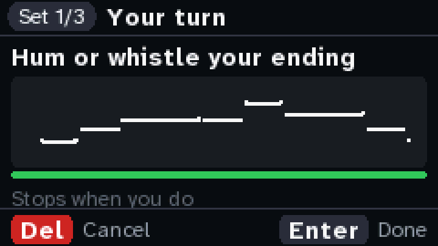
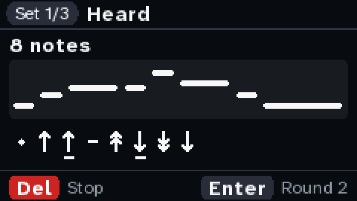
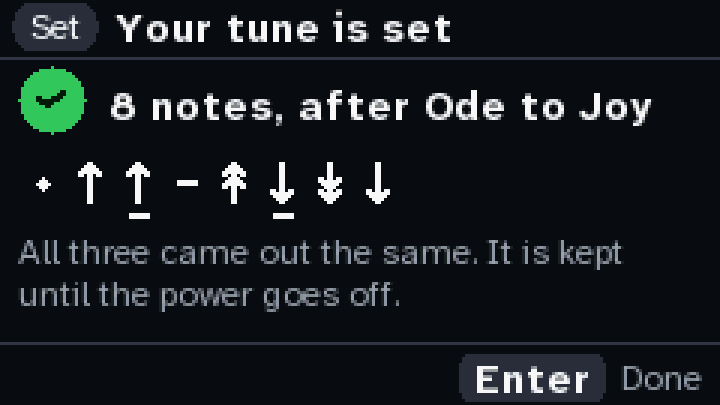
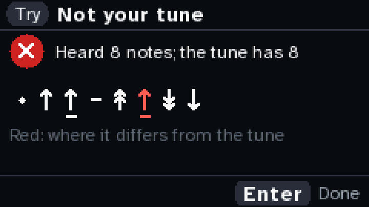

# A tune as a second factor

The Cardputer plays the first notes of a common tune. You hum or whistle your own ending into its
mic. It turns what it heard into a code, and checks the code against the one you set.

> **An experiment, written 2026-10-19.** It is an image of its own (`firmware/src/bin/hum.rs`),
> like the key ceremony. It never wakes the chip, nothing in it signs, and the tune is kept in RAM
> until the power goes off. It has been built and tested on a laptop, but hasn't run on a
> Cardputer yet. [What only the bench can settle](#what-only-the-bench-can-settle) says what to
> look at the first time.

| | | | |
|---|---|---|---|
|  |  |  |  |
| **Your turn.** The pitch, live. | **Heard.** The notes, and the code. | **Set.** Three goes the same. | **A try.** Red where it differs. |

These pages are drawn on a laptop by the same code the image runs (`cargo run --example hum`), from
a test tune played by the device's own tones.

## Try it

**This replaces whatever is on the board.** Keep an image first, as in the [README](../README.md#flash-it).

```sh
cd firmware && cargo run --release --bin hum    # flashes the hum image, then shows its log
cd firmware && cargo run --release              # the signer back, when you're done
```

The keys: `;` and `.` up and down, `,` and `/` left and right, Enter, and Del to go back.

1. **Check the mic.** Hum or whistle. The bar of the slot in use should move, and the note you're
   on should show. The mic is on one of two PDM slots, and the image picks the one with sound. If
   it picked the quiet one, `,` and `/` choose slot 1 or 2 by hand, and Enter goes back to picking.
2. **Set your tune.** Pick an opening with `,` and `/`, and press Enter. It plays the opening. When
   the page says "Your turn", hum or whistle your own ending: 6 to 24 notes. It stops 1.5 s after
   you do, or press Enter. It asks three times, and the three must come out the same.
3. **Try your tune.** Once. It says whether it matched, and marks in red where it didn't.

What helps:
- **A break between repeated notes**, as in "hm hm" or "tu tu". Held without one, two notes on the
  same pitch are one note.
- **Clear steps and leaps.** A step is a tone or less; a leap is a minor third or more.
- **Long notes about twice as long as short ones.**
- **Your own ending, not the song's.** Anyone who knows the song knows its ending.

## What it keeps of a tune

Only what a person hums the same way each time. For each note after the first: whether it goes up,
down or stays the same, and whether by a step (under 2.5 semitones) or a leap. And for each note but
the last, whether it is long. Not the key, the speed or the voice: you can hum it low and slow and
whistle it high and fast, and it is the same tune. So anyone who learns it can do it too.

On the screen, a dot is the first note, an arrow is a step, an arrow with two heads is a leap, a
bar is the same note again, and a line underneath marks a long note.

## How it's built

- **The listening** is in `core/src/hum.rs`, `no_std` and no heap, and runs on the laptop:
  - `Mic` takes the mic's two slots at 32 kHz, picks the slot with sound, and halves the rate to 16 kHz.
  - `Listener` finds the pitch every 10 ms with YIN (de Cheveigné and Kawahara, 2002), from 75 Hz
    to 4 kHz. For a high whistle it reads the period off a dip several periods along, which is
    finer.
  - `Listener::notes` cuts the pitch track into notes:
    - a gap of 30 ms or more, or a dip 9 dB under the note, ends a note
    - so does the pitch leaving the note by 0.4 semitones for 80 ms, measured on a median over
      210 ms, which flattens a vibrato
    - what's left of a glide is joined to the notes either side
  - `Code::of` keeps the moves and the long notes. Which notes are long, it decides from the tune
    itself: the lengths split in two where they separate best, if the long ones are 1.5 times the
    short ones on average.
  - `Tones` plays the openings: four notes each, an octave up for the small speaker.
- **The pages** are in `core/src/hum_pages.rs`, driven the same way as the ceremony's.
- **The image** is `firmware/src/bin/hum.rs`. The speaker (NS4168) and the mic (SPM1423, PDM)
  share G43: the speaker's LRCLK is the mic's clock. So it plays, then listens, never both:
  - **The speaker** is I2S1, Philips 16-bit stereo at 16 kHz, on G41 (BCLK), G42 (data) and G43.
  - **The mic** is I2S0 in PDM mode, through the S3's PDM-to-PCM filter: esp-hal 1.2.2's
    `I2s::new_pdm`, at 32 kHz, so a 2.048 MHz clock on G43 and data on G46.
  - It takes these from the board with `steal()`, because `Board::new` takes every peripheral.
    `Board::new` uses none of them. No new crate.
- **The log** over USB says how each go went: how long it listened, how long the analysis took,
  the slot and both slots' levels, and how many notes over how many frames; then whether the tune
  was set, matched or not. Never the code or the pitches.

## What was checked, and how

On a laptop, not on a Cardputer:

- `cargo test` in `core`:
  - **Pitch:** a pure tone or a hum from 80 Hz to 3 kHz comes out within a tenth of a semitone.
  - **Noise** is never a note.
  - **The openings:** played by `Tones` and heard by the listener, each comes back note for note.
  - **The same code:** a test tune is hummed in other keys, 15% faster and slower, a little off,
    with vibrato, with glides and in a noisy room, and whistled up to two octaves higher. Every
    one of these gives the same code. Another tune gives another code.
  - **The slot:** the mic's slot is picked whichever of the two carries the sound.
  - **The pages:** a tune set in three goes; a try that matches and one that doesn't; three goes
    that differ set nothing; too few notes; Del backs out with one press; the mic page. Every page
    draws.
- **A sweep of random takes** (`RUNS=100 DRIFT=0.2 JITTER=25 cargo test --release --lib sweep --
  --ignored --nocapture`): three test tunes, 100 takes each. Each take has a random key and speed,
  hum or whistle, vibrato up to ±0.3 semitones, glides up to 50 ms, room noise, and each note off by
  up to the drift (semitones) and the jitter (ms). How many of the 300 came out with a different
  code:

  | each note off by up to | different |
  |---|---|
  | ±0.1 semitones, ±10 ms | 0 |
  | ±0.2 semitones, ±25 ms | 2 |
  | ±0.2 semitones, ±40 ms | 4 |
  | ±0.3 semitones, ±25 ms | 49 |

  So a tune comes back the same when each note is within about a fifth of a semitone. Past that,
  the same note and a half step start to swap. These are synthetic hums. How steady a person is,
  only people can show.
- **The image builds** for `xtensa-esp32s3-none-elf`, 245 KB, and clippy passes on all three
  images.
- **The signer and the ceremony:** adding `hum` to `core` changed their images' layout, not their
  code, as on 2026-10-13. All 91 of their screens came out the same, byte for byte.
- `web/build.sh`, `node web/test.mjs` and `node web/e2e.mjs` pass.

## What only the bench can settle

- **Does the speaker play?** It should play the opening, clearly, not too loud.
- **Does the mic give sound?** On the mic page, which slot moves, and does the note shown match what
  you hum? The log's levels say how loud the mic reads. A frame counts as sound when it is periodic
  and 10 dB over the quietest stretch, and at least RMS 4. That floor is a guess until then.
- **Does the analysis keep up?** In the log, "analysis" should be well under "listened".
- **How often three real goes come out the same.**

## What this is, and isn't

It is a test of how well a hum can become a code that comes out the same each time. It isn't
protection, and nothing here signs. If it ever stood in front of Sign:

- **In the firmware**, it would stop someone who uses your Cardputer as it is. It wouldn't stop
  someone who flashes other firmware, because there is no secure boot. The check value would also
  sit in flash, where it can be read out and guessed offline in minutes.
- **In the chip**, the 608 can refuse to use slot 0 until a second key in another slot is proven
  (its ReqAuth and AuthKey rules), and that key could be made from the tune's code. That needs a
  new table on a fresh chip, which is a permanent step. And the chip has no lockout
  ([CEREMONY.md](CEREMONY.md), decision 4). By a rough guess, a made-up tune of 8 to 12 notes is
  about as hard to guess as a 6-digit PIN.
- **Either way**, you perform it each time you sign. A recording of it, played to the mic, passes.

The Safe's threshold stays the protection.
